# Reference Reel Deconstruction & Production Roadmap

> **Reference URL:** [Instagram Reel `Dfo7jS8tXiK`](https://www.instagram.com/reel/Dfo7jS8tXiK/)  
> **Source Media Analyzed:** `reel_dfo7js8.mp4` (136.2s, 720×1280 @ 30fps)  
> **Transcribed & Deconstructed:** Frame-by-frame visual analysis + Whisper AI audio sync

---

## 1. Executive Summary: Understanding Your Exact Expectation

The analysis of your reference video reveals why previous attempts fell short:

| Past Attempts (What Was Wrong) | Your Real Expectation (From Reference Reel) |
| :--- | :--- |
| **Static AI image snapshots** with 2D pan/zoom effects | **True 3D Character Animation** where avatars physically walk, do pull-ups, throw objects, and interact |
| **Dark, grim, photorealistic horror** aesthetic | **Bright, vibrant, saturated Roblox 3D low-poly** cartoon universe |
| **Vague AI morphing** with no clear physical actions | **Clear character choreography** (pull-ups on bars, facial expressions, physics trails) |
| **Generic cinematic score & slow narration** | **High-energy viral TikTok/Reels storytelling** (fast-paced AI voice, snappy SFX, coin pops) |
| **Paragraph subtitles / missing text** | **Word-by-word kinetic yellow captions** with thick black outline and soft drop shadow |

This reference video belongs to the viral **"Roblox Story / Brainrot Lore"** genre (popularized on TikTok and YouTube Shorts by creators like *Steak*, *KreekCraft*, and *Roblox Story Animations*).

---

## 2. The 5 Core Pillars of the Reference Style

```mermaid
flowchart TD
    A["Roblox 3D Story Formula"] --> B["1. Visual & Rigging Style"]
    A --> C["2. Dynamic 3D Character Motion"]
    A --> D["3. High-Concept Story Arc"]
    A --> E["4. Voice & Sound Design"]
    A --> F["5. Viral Subtitles & Camera"]

    B --> B1["Blocky R6/R15 Avatars, Cylindrical Heads, 3D Mesh Hair"]
    B --> B2["Vibrant Low-Poly Modular Town, Pastel Houses, Clean Shadows"]

    C --> C1["Physical Pull-ups, Throwing Wind-ups, Running, Bowing"]
    C --> C2["Facial Reactions: Gritted Teeth (>_<), Shock, Smiles"]

    D --> D1["Rule Hook: 'In this town, you throw food...'"]
    D --> D2["Underdog Progress: Kevin the Frog -> Golden Cheese -> Dragon"]
    D --> D3["Cliffhanger Twist: Giant food falling from the sky"]

    E --> E1["Punchy AI Narrator (ElevenLabs Adam / Antoni style)"]
    E --> E2["Layered SFX: Coin pops, swooshes, heavy boom impacts"]

    F --> F1["1-2 Word Centered Kinetic Yellow Captions with Black Stroke"]
    F --> F2["Fast Cuts (2-3s per shot), Camera Tracking Projectiles"]
```



---

## 3. Frame-by-Frame Visual Breakdown

```carousel

<!-- slide -->

<!-- slide -->

<!-- slide -->

<!-- slide -->

<!-- slide -->

<!-- slide -->

<!-- slide -->

<!-- slide -->

```

### Visual Specifications
- **Render Engine:** 3D Real-time / Eevee low-poly shading.
- **Lighting:** Crisp directional sunlight with soft ambient shadows, bright skybox with low-poly clouds.
- **Color Palette:** Saturated primary and secondary tones (Cyan `#00B4D8`, Lemon Yellow `#FFD60A`, Crimson Red `#E63946`, Emerald Green `#2A9D8F`).
- **Characters:** Classic blocky Roblox R6/R15 proportions. Smooth face texture swaps for expressions (`happy`, `strained gritting teeth >_<`, `mouth open speaking`, `shocked wide eyes`).
- **Effects:** Glowing dotted trajectory lines, sparkle particles, coin shower emitter, purple volumetric lighting for the titan.

---

## 4. Full Audio Script & Beat Sheet Analysis

The pacing moves at **165–175 words per minute** with high vocal energy and zero dead space:

| Timestamp | Narrative Beat | Visual Action & Camera | Audio & SFX |
| :--- | :--- | :--- | :--- |
| **0.0s – 5.2s** | **The Hook:** *"In this town, you don't buy animals, you throw food, and whatever comes running is yours."* | Wide street shot. A citizen throws a banana over the hill. | High-tempo cheerful groove + whistling throw whoosh. |
| **5.2s – 9.7s** | **Comic Demonstration:** *"See that guy? ... Now there's a gorilla living in his garage."* | Cut to suburban driveway. Big low-poly gorilla sitting in garage waving. | Sub-bass pop + gorilla grunt. |
| **9.7s – 27.1s** | **The Economy Rule:** *"Throw a carrot... get a frog. Throw an apple... fox. Throw a steak... lion... and animals make money! Gold coins pop right out of them."* | Quick successive cuts showing foxes, lions, and penguins dropping shiny gold coins. | Coin ding sounds (`ding-ding-ding`) synced to coin pops. |
| **27.1s – 47.4s** | **World Progression:** *"My neighbor has 40 penguins... Grandma does 500 pull-ups before breakfast. Threw a cheeseburger... now owns a polar bear."* | Montage of pull-up bars on street corners, burger flying through clouds for 3 days. | Upbeat training tempo + comedic sound cues. |
| **47.4s – 65.0s** | **The Underdog:** *"But me, I had the weakest arms... carrot flew three feet, got a frog named Kevin. Everyone laughed. So, I trained."* | Eli on pull-up bar, strained face (`>_<`), arms lifting and lowering torso. Day counter badge. | Motivation riser sound effect + heavy breathing. |
| **65.0s – 95.0s** | **The Climax Throw:** *"Bought the most expensive food: The Golden Cheese. Took a deep breath, and I threw it."* | Slow-motion wind-up. Throw release. Dynamic 3D camera follows glowing cheese across forest, desert, volcano, haunted carnival. | Cinematic rising sweep + shimmering magic sound. |
| **95.0s – 115.0s** | **The Grand Reward:** *"Boom! Something was flying over the mountains. A dragon made of pure gold... it landed and bowed."* | Giant golden voxel dragon descends, lands on athletic field, bows to Eli and Kevin. Coins rain everywhere. | Heavy sub-bass thud + brass swell + coin rain. |
| **115.0s – 136.2s** | **The Cliffhanger Twist:** *"That night, a giant carrot crashed into town square... Then a steak the size of a football field... We weren't the only ones throwing food."* | Night sky. Colossal food strikes ground with shockwaves. Camera pans up to reveal a monstrous shadow titan with glowing purple eyes over the mountain. | Sudden silence -> deep ominous rumble -> thunderous bass drop. |

---

## 5. Kinetic Subtitle Design

The captions are formatted for maximum short-form retention:
- **Display Mode:** 1 to 2 words at a time, strictly synchronized to the spoken word.
- **Font:** Bold, clean sans-serif (Impact / Montserrat ExtraBold / Arial Black).
- **Styling:**
  - Fill Color: `#FFE81F` (Bright Sunshine Yellow)
  - Stroke: `#000000` (Thick 3px outline)
  - Drop Shadow: Subtle 2px black blur
  - Scale Pulse: Subtle 5% pop on every new word entry.

---

## 6. How We Will Build Videos In This Exact Style

To deliver videos that match this standard instead of static slideshows, we use a dedicated **3D Animation & Procedural Scene Pipeline**:

1. **Character & Environment Pipeline:**
   - 3D Rigged Roblox models (R6/R15 armature with inverse kinematics for pull-ups, walking cycles, and throwing motions).
   - Low-poly modular suburban pack (pastel houses, streets, pull-up bars, sports field).
   - Expression morph targets / texture UV offsets (smiles, gritted teeth, shocked eyes).

2. **Animation & Camera Choreography:**
   - Pre-built motion sequences:
     - Pull-up cycle with torso oscillation and arm flexion.
     - Throwing wind-up and release with physics trajectory tracking.
     - Walk/run cycles.
   - Dynamic 3D camera with depth of field and motion blur.

3. **Audio & Narration Pipeline:**
   - High-energy AI voiceover at 165+ WPM.
   - Layered sound effects track (throw whooshes, coin ding chimes, footsteps, thuds).
   - Adaptive background music matching emotional story beats.

4. **Automated Word-by-Word Caption Generator:**
   - Precise Whisper timestamps generating the yellow-black stroked kinetic text overlay.
